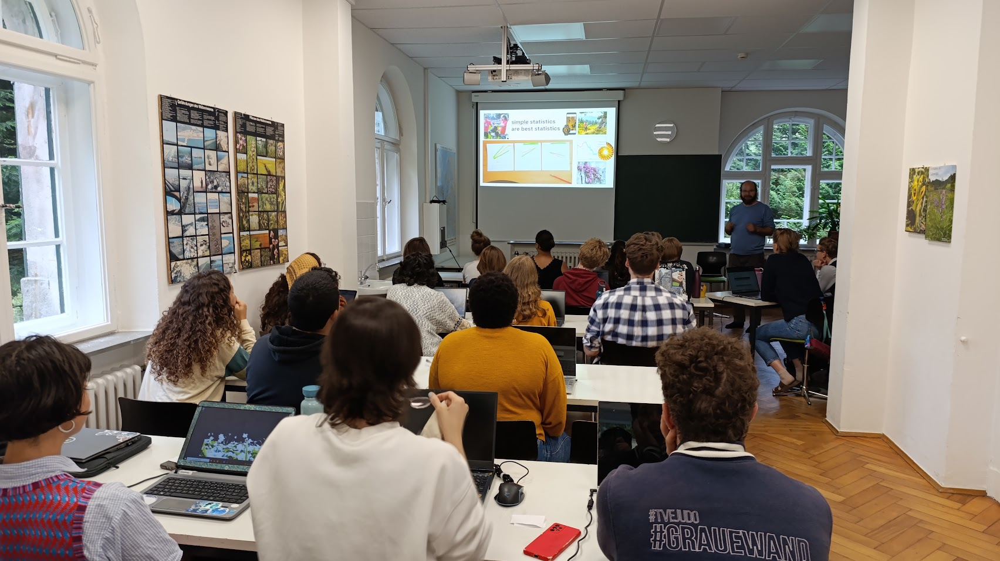

Can you imagine? In 2026, we had our third Science School once again in Wallenfels, Germany. In mid-September, 22 participants from Charles University, the University of Bayreuth, and other European institutions met at the University of Bayreuth's outstation for a week full of quantitative ecology. We spent the week exploring ecological data and methods with quantitative tools, sharing new ideas, and building stronger scientific connections between Czechia and Germany.


Every day was full of scientific talks, practical sessions and discussion. The speakers all brought very different angles to the programme. Ondra introduced version control, showed how to make data analysis more reproducible and enable collaborative projects. Anna looked at species distribution modelling and the way it can be used to understand where species are and where they might be in the future. Manuel took us into the world of community analysis and palaeoecological data, Gregor continued the programming sessions and introduced some further computational approaches. Antonin then moved the discussion up to the macroecological level, looking at ecological and phylogenetic patterns at large spatial and temporal scales. Franka brought in deep learning and introduced the group to another set of tools for working with complex ecological data. Together, these sessions showed how many different approaches can fall under the umbrella of quantitative ecology. The questions raised along the way often reached beyond the methods themselves, leading to discussions about how we conduct research, how we interpret ecological data, and how different analytical approaches can shape the questions we ask.

But the week was about more than just screens and lectures. We shared meals and relaxed in the evenings, where conversations flowed, new research ideas took shape, and friendships grew across different backgrounds. The program also encouraged people to go outside the lecture halls. A hike through the surrounding countryside was a great way to experience the tranquillity of rural Germany and see Wallenfels for themselves. Some visited a tin figure museum, others wandered the historic streets of Kronach. Of course, it was a well-earned break after all the scientific input.



With every edition, the Science School brings a new cohort of researchers into a growing community of people who are all driven by a shared sense of curiosity and a desire to learn from each other. Our week in Wallenfels was a mixture of methodological training, some very stimulating discussions, some time outdoors and a host of new personal contacts. People left with new ideas, new skills and a number of connections that are likely to continue to develop long after the school has finished.

## Funding

A big thank you to our participants, lecturers and funder, the [Bavarian-Czech Academic Agency (BTHA)](https://www.btha.cz/en/)!

```{r}
#| label: R-setup
#| include: false
options(htmltools.dir.version = FALSE)
knitr::opts_chunk$set(
  fig.width = 7,
  fig.height = 5,
  fig.align = "center",
  out.width = "100%"
)
```

```{r}
#| label: logo-BTHA
#| echo: FALSE
knitr::include_graphics("https://www.btha.cz/images/logo/logo-full-583x100px-01.png")
```
